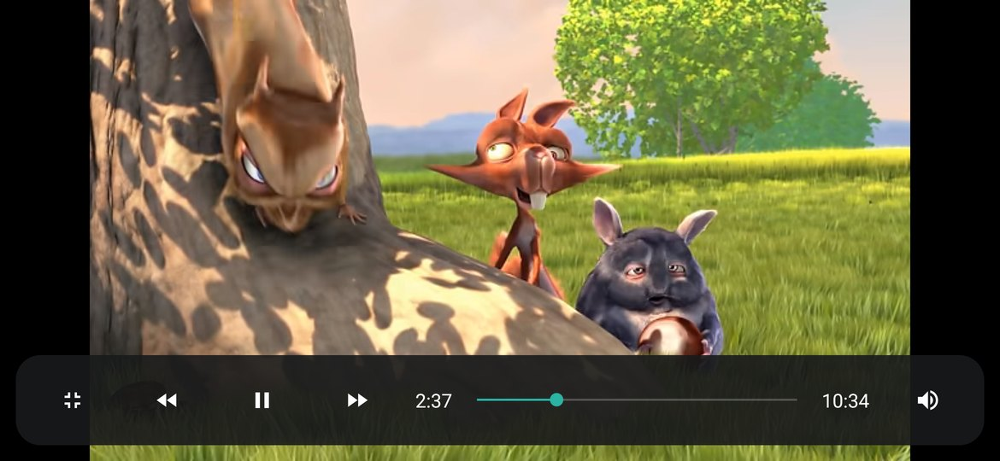
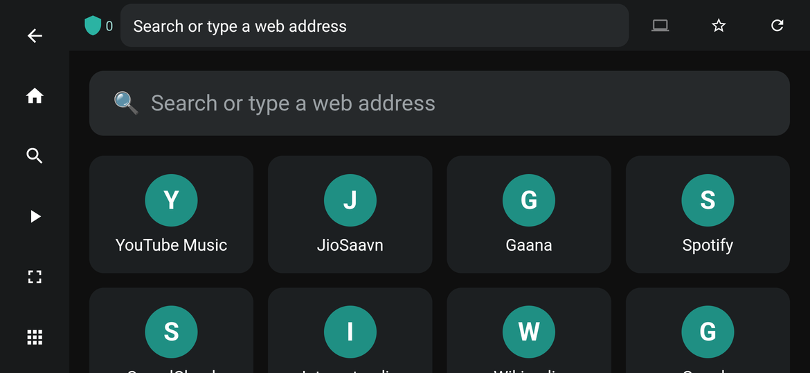
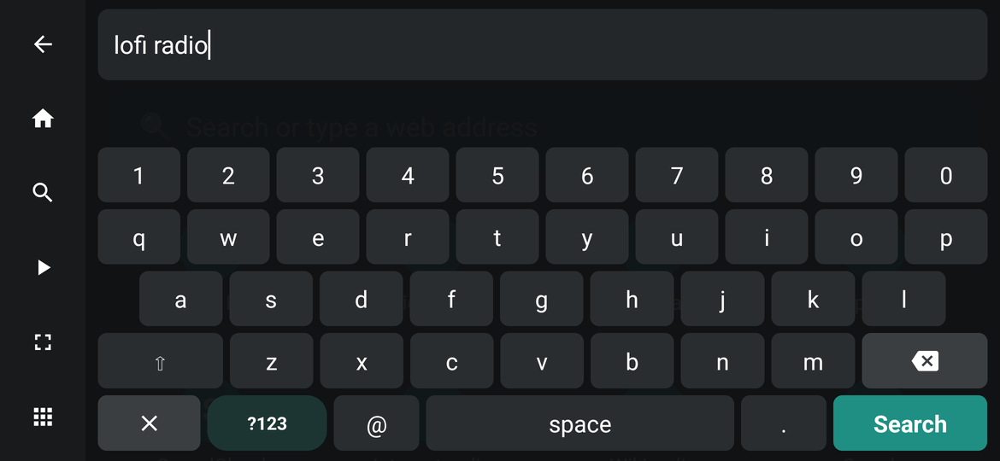
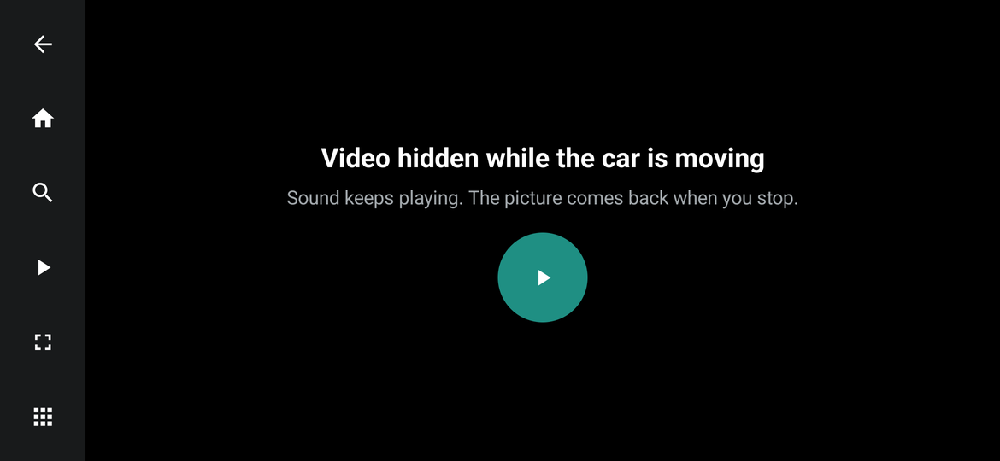

<div align="center">

# AutoTube 🚗📺

### Watch YouTube, Prime Video and any website on your Android Auto car screen

**Free · Open source · No root · No computer needed · Works with YouTube and YouTube ReVanced**

[](https://github.com/debkol35/autotube/releases/latest)
[](https://github.com/debkol35/autotube/releases)
[](#-faq)
[](https://github.com/debkol35/autotube/stargazers)

<a href="https://github.com/debkol35/autotube/releases/latest/download/AutoTube.apk"></a>



</div>

Android Auto doesn't let you watch videos, even when the car is parked and you're waiting. **AutoTube adds a video app and a web browser to the Android Auto screen.** Pick a video on your phone, tap Share → "Play in car", and it plays on the big screen. The picture shows only while the car is parked.

> Unofficial app: not made by, endorsed by or affiliated with Google, YouTube, Amazon or Android Auto.

## ✨ Highlights

| | |
|---|---|
| 📺 **YouTube on the car screen** | Search, browse and play with big car-friendly buttons. Signs in with your own account. |
| 🧩 **Works with YouTube *and* ReVanced** | Send videos from either app with Share → "Play in car". |
| 🛡️ **Ad-free browsing** | Built-in browser blocks ads, trackers and pop-ups (80,000+ ad domains, updated weekly). |
| 🎬 **True full screen** | Video fills the whole car screen. Tap it for a seek bar, ±10 s, play/pause and mute. |
| 🌐 **Any website** | Music, radio, videos, films. Bookmarks, desktop-site mode, start page with quick tiles. |
| 🍿 **Prime Video** | Optional. Sign in on the phone, watch on the car screen. |
| ⌨️ **Car keyboard** | Big keys, search suggestions, @ and symbols for logins, passwords masked. |
| 🚦 **Driving lock** | GPS-checked: the picture hides while moving, the sound keeps playing. |
| 📱 **Phone-only install** | No root, no PC. Install the APK and tap one button. |

## 📸 Screenshots

<table>
<tr>
<td><br><sub><b>Browser with ad blocking</b>: start page, address bar, bookmarks</sub></td>
<td><br><sub><b>Car-sized keyboard</b>: search, emails and passwords</sub></td>
</tr>
<tr>
<td><br><sub><b>Full screen</b> with seek bar, ±10 s and mute</sub></td>
<td><br><sub><b>Driving lock</b>: picture hidden while moving</sub></td>
</tr>
</table>

<sub>Screenshots from the Android Auto desktop head unit. Video: <i>Big Buck Bunny</i> © Blender Foundation, CC BY 3.0.</sub>

## 🚀 Install in 2 minutes (no computer)

1. **[Download the APK](https://github.com/debkol35/autotube/releases/latest/download/AutoTube.apk)** on your phone and install it (allow "install unknown apps" if asked).
2. Open AutoTube and tap **"Set up on this phone"**, then **Update**. Android Auto only lists AutoTube after this step.
3. Allow location **"all the time"** (for the driving lock).
4. In Android Auto → **Customize launcher**, turn on **AutoTube**.
5. Connect to the car and open AutoTube. 🎉

If your phone refuses step 2, the app guides you to the free [Shizuku](https://shizuku.rikka.app/) app. There's also a one-click Windows / Mac / Linux installer in the release zip. Details: [`installer/README.txt`](installer/README.txt).

**Updating:** install the new APK over the old one, then tap "Set up on this phone" again.

## ❓ FAQ

<details>
<summary><b>Can I watch YouTube on Android Auto?</b></summary>

Yes, with AutoTube, while the car is parked. Android Auto has no video app of its own; AutoTube adds one using Android Auto's projection screen.
</details>

<details>
<summary><b>Do I need root, a custom ROM or a computer?</b></summary>

No. A normal phone with Android 10 or newer and the Android Auto app. Most phones set up with one tap. Some need the free Shizuku app or the computer installer once.
</details>

<details>
<summary><b>Does it work with YouTube ReVanced?</b></summary>

Yes. Share a video from YouTube or YouTube ReVanced and pick "Play in car (AutoTube)". If both are installed, you choose which one AutoTube opens.
</details>

<details>
<summary><b>Does it block ads?</b></summary>

The browser blocks ads, trackers and pop-ups (a built-in list plus the [StevenBlack hosts](https://github.com/StevenBlack/hosts) list, refreshed weekly). On YouTube there's an optional ad skipper, which you can switch off. Skipping YouTube ads goes against YouTube's terms; it's your choice.
</details>

<details>
<summary><b>Netflix? Disney+? Hotstar?</b></summary>

Netflix refuses in-app browsers (error M7111-1957) and blocks screen mirroring, so it can't work. Prime Video works. Other sites can be tried in the browser; protected video may refuse or show a black picture.
</details>

<details>
<summary><b>Can I watch while driving?</b></summary>

No, and please don't. The driving lock (on by default) hides the picture unless GPS confirms the car is parked. Passengers can switch it off in the phone app, after a warning. You are responsible for following your local laws.
</details>

<details>
<summary><b>Why isn't it on the Play Store?</b></summary>

Google doesn't allow video apps on Android Auto in the Play Store. AutoTube is distributed here as a free APK.
</details>

<details>
<summary><b>Is it safe? What does it collect?</b></summary>

Nothing. There are no accounts, analytics or trackers of our own, and the full source code is here. AutoTube connects only to:
- the sites you open;
- Google's search-suggestion service, for keyboard suggestions;
- GitHub, for the ad-block list.
</details>

<details>
<summary><b>It closes when I move it to the other side of the screen</b></summary>

A known issue on some Android Auto layouts that is still being investigated. Please share the car log (phone app → Settings → Share car log) in an [issue](https://github.com/debkol35/autotube/issues).
</details>

## ⭐ Help AutoTube grow

If AutoTube makes your waits in the car better, **star this repo** and share it with friends, car groups and forums. It's free, and it helps others find it. Bugs and ideas are welcome in [Issues](https://github.com/debkol35/autotube/issues).

---

## All features

- **Works with the original YouTube app and YouTube ReVanced.** The car screen plays YouTube's mobile website inside AutoTube. On the phone you pick videos in either app and tap Share → "Play in car (AutoTube)". If both are installed, the user chooses which one AutoTube opens.
- **Car-friendly controls:** a big button rail (Back, Home, Search, Play/Pause, Full screen, Apps) and its own big keyboard with YouTube search suggestions. Password fields are masked on the car screen.
- **Full screen:** shows only the video, using all of AutoTube's area on the car screen. Tap the screen for the control bar: exit, back/forward 10 s, play/pause, a seek bar with elapsed and total time, and mute.
- **Web browser with ad blocking:** Apps → Browser opens any website (music, radio, videos, films). It has an address bar (search or type an address), bookmarks on its start page and a desktop-site switch. Ads, trackers and pop-ups are blocked using a built-in list plus the [StevenBlack hosts](https://github.com/StevenBlack/hosts) list (MIT), downloaded and refreshed weekly by the app.
- **Prime Video (optional):** the user turns it on and signs in on the phone. It loads in a desktop browser mode with Widevine DRM. Confirmed working on a Samsung Galaxy (Android 17). Other phones or cars may still refuse protected video or show a black picture, and on phones with only software DRM it plays in standard definition.
- **No Netflix:** Netflix's licence check refuses in-app browsers (error M7111-1957-2050xx), and its app blocks screen mirroring. If the car has an Android head unit, run the Netflix app there instead.
- **Fail-safe driving lock, on by default:** the picture shows only while the phone's GPS confirms the car is parked. It stays covered while moving, without location permission, with GPS off, or before the first GPS reading. The sound keeps playing. Passengers can switch it off in the phone app, after a warning.
- **Optional ad skipping:** works like ReVanced and can be switched off in Settings.
- Resumes the last video, and links sent from the phone wait until the car screen opens.
- **Car log:** start/stop, size changes and crashes go to a small log. Users can send it from the phone app's "Share car log" button.

## How it gets onto the car screen

- **Unofficial SDK:** it uses the unofficial Android Auto projection SDK (`CarActivityService` / `CarActivity`, `app/libs/aauto.aar`, the same build Fermata Auto uses).
- **The install check:** Android Auto 17.7+ only lists such apps when the install record says `installer = com.android.vending` and was made by `com.google.android.packageinstaller`.
- **Who may ask for it:** the phone's installer must be asked to record Play Store (`am start ... INSTALL_PACKAGE` with `EXTRA_INSTALLER_PACKAGE_NAME`). Which callers it accepts depends on its version:
  - **Classic installer (Android 14–16):** accepts the request only from callers with install rights, meaning `adb shell` or [Shizuku](https://shizuku.rikka.app/).
  - **Newer installer** (it logs "Use PIA V2"; seen on Android 17): rejects exactly those callers, logging `The given installer package name … is invalid`. It accepts the request from an ordinary app asking for itself. See `maybeRemoveInvalidInstallerPackageName` in AOSP's `InstallRepository.kt`.
  - **What AutoTube does:** "Set up on this phone" makes the request itself. The Shizuku route (`ShizukuSetup` in `Installer.kt`) and the computer scripts (`installer/`) send it as shell. When they see the rejection in the log, they hand over to the app.

## Build

```
./gradlew assembleRelease
```

Signing reads `keystore/keystore.properties` (`storeFile`, `storePassword`, `keyAlias`, `keyPassword`). That file and the keystore are git-ignored.

**Keep the key private and backed up.** Updates must be signed with the same key, or users have to uninstall first.

The build output goes to `~/.autotube-build` (see the root `build.gradle.kts`).

## Make a release

1. Bump `versionCode` and `versionName` in `app/build.gradle.kts`, then build.
2. Make a folder `AutoTube-vX.Y` containing:
   - the APK, renamed `AutoTube-vX.Y.apk`
   - everything in `installer/`
3. Zip that folder and attach the zip to the release.
4. Attach the APK twice: as `AutoTube-vX.Y.apk`, and as **`AutoTube.apk`**. The README's download button links to `releases/latest/download/AutoTube.apk`, so every release needs that exact name.

## Notes before publishing

- **Not for Play Store:** Google doesn't accept third-party projection or video apps for Android Auto, so distribute the APK yourself (GitHub Releases, for example).
- **YouTube's terms:** skipping ads goes against them. The feature is a user setting and the app shows a notice on first run.
- **The SDK is not open source:** `aauto.aar` is Google's unreleased SDK as redistributed by other projects, and its license is unclear.
- **The name:** "AutoTube" and any use of "YouTube" can draw trademark complaints. Keep YouTube's logo out of the app icon and store listings, and consider a distinctive name.
